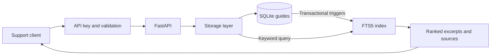

# Support Knowledge Base API

**Keep support guides searchable, current and safe from conflicting edits.**


*AI-generated concept illustration, not a screenshot of the application.*

A small Python backend for a support guide library. Store instructions for account access, billing and delivery, then find relevant passages with their sources. When a guide changes, update it without silently overwriting another editor's work.

Built with **Python 3.12 · FastAPI · SQLite FTS5 · pytest**. It works locally without model downloads or external API accounts. Search returns stored passages, not AI-generated answers.

[Quick start](#quick-start) · [API](#api-at-a-glance) · [Walkthrough](docs/walkthrough.md) · [Security](SECURITY.md) · [Usage rights](LICENSE)

## A practical example

A customer asks how to track a delivery. A support agent searches for `tracking reference` in the `delivery` category and gets the relevant guide, its source label and its version.

Later, the delivery policy changes. One editor saves the correction. A second editor still has the old version open: their save receives `409 Conflict` instead of replacing the first correction. They can fetch the current guide and reconcile the changes.

| Need | What the API provides |
|---|---|
| Find the right instruction | Ranked title/content search with source excerpts |
| Keep guides organized | Account, billing, delivery and general categories |
| Correct an outdated guide | Full replacement with an explicit version check |
| Avoid duplicate submissions | Database-enforced uniqueness, including concurrent writes |
| Remove an obsolete guide | Document and search entry deleted in one transaction |
| Inspect or integrate the API | Typed JSON responses and interactive OpenAPI docs |

## How it fits together



The HTTP layer handles validation and errors; the storage layer owns SQL and transactions. No document content is sent to another service. The included sample guides are fictional.

## Quick start

For authorized local use under the [repository's usage terms](LICENSE), use **Python 3.12** and a SQLite build with FTS5. The code and tests were verified with this Python version.

```bash
python3.12 -m venv .venv
source .venv/bin/activate
python -m pip install -r requirements.txt
python -m pip install --no-deps -e .
export DOCSEARCH_API_KEY="$(python -c 'import secrets; print(secrets.token_urlsafe(32))')"
uvicorn docsearch.main:create_app --factory --host 127.0.0.1 --port 8000 --no-access-log
```

Open [localhost:8000/docs](http://127.0.0.1:8000/docs), choose **Authorize**, and enter your generated key. To see its value in the server terminal, use `echo "$DOCSEARCH_API_KEY"` before starting the server. Keep the key private.

In another terminal, activate the same environment and set `DOCSEARCH_API_KEY` to the server's key. Load the three fictional guides and search:

```bash
python examples/load_demo.py
curl -s --get http://127.0.0.1:8000/search \
  -H "X-API-Key: $DOCSEARCH_API_KEY" \
  --data-urlencode 'q=tracking reference' \
  --data-urlencode 'category=delivery'
```

An abbreviated result:

```json
{
  "query": "tracking reference",
  "items": [
    {
      "id": 1,
      "title": "Tracking a parcel",
      "source": "fictional-parcel-guide",
      "category": "delivery",
      "version": 1
    }
  ]
}
```

The full response also includes `excerpt` and `rank`. IDs depend on the database contents. Re-running the loader reports duplicates without inserting them again.

The database defaults to `var/documents.sqlite3`; set `DOCSEARCH_DB` to use another path. A valid key is required on startup. The health endpoint and API schema are public, while document and search routes require `X-API-Key`.

## API at a glance

| Method | Route | Behavior |
|---|---|---|
| `GET` | `/health` | Process liveness; not a database readiness check |
| `POST` | `/documents` | Create a guide; `201` and `Location` |
| `GET` | `/documents` | List guides with `category`, `limit` and `offset` |
| `GET` | `/documents/{id}` | Read a guide and its current version |
| `PUT` | `/documents/{id}` | Replace a guide using `expected_version` |
| `DELETE` | `/documents/{id}` | Remove a guide and its live search entry |
| `GET` | `/search` | Search with `q`, optional `category` and `limit` |
| `GET` | `/docs` | Explore the OpenAPI contract interactively |

Example create request:

```json
{
  "title": "Delivery timing",
  "content": "Standard delivery takes three days.",
  "source": "fictional-support-policy",
  "category": "delivery"
}
```

Categories are `general`, `accounts`, `billing` and `delivery`; omitted category defaults to `general`. The source is a client-supplied label, not a verified citation or a URL fetched by the server.

To edit, send all fields plus `"expected_version": 1`. Every successful edit increments the version and updates the timestamp. A stale version returns `409`; the client should fetch the latest guide before deciding how to retry. Deletion is unconditional, so version checks protect edits rather than concurrent deletes.

```mermaid
sequenceDiagram
    participant A as Editor A
    participant API as API and database
    participant B as Editor B
    A->>API: Read guide
    API-->>A: Version 1
    B->>API: Read guide
    API-->>B: Version 1
    A->>API: Save with expected_version 1
    API-->>A: Saved as version 2
    B->>API: Save with expected_version 1
    API-->>B: 409 Conflict; fetch current guide
```

The version check and update are a single conditional SQL statement. Index triggers run in the same transaction, so a failed edit does not leave search out of sync. See the [curl walkthrough](docs/walkthrough.md) for the complete lifecycle.

## Search and validation

- Search uses BM25 with title matches weighted more heavily. Lower `rank` sorts first; the score is not a confidence percentage.
- Query words are literal and combined with **AND**. There are no user-supplied FTS operators, synonyms, semantic matching or generated answers.
- Duplicate detection compares the trimmed title, content and source. A different category alone does not make an identical guide distinct.
- Limits: 200 characters for title/source/query, 16,000 for content, 50 results per page and 64 KiB per write request.
- Errors: `401` invalid key, `404` missing guide, `409` duplicate/stale edit, `413` oversized body, `422` invalid input and `503` unavailable storage.

Excerpts and labels are plain text. Clients should render them as text, not HTML. A search match does not prove the underlying guide is correct.

## Verify it

```bash
python -m pip install -r requirements-dev.txt
python -m pytest -q
```

**31 test cases** cover the lifecycle, access control, validation, category filters, duplicate races, conflicting edits, index updates, persistence and legacy schema upgrades. Tests use temporary databases and need no network access. A GitHub Actions workflow runs the suite on Python 3.12.

```text
src/docsearch/main.py    HTTP contract, validation and access control
src/docsearch/store.py   Persistence, transactions and ranked search
tests/test_api.py       API and storage behavior
examples/               Fictional guides and API loader
docs/walkthrough.md     A support guide from creation to correction
```

## Scope and tradeoffs

This is a local portfolio backend, not a hosted support platform. SQLite keeps setup simple; it serializes writes and is not a multi-host database. Each operation uses its own connection, and filtered lists use a consistent read snapshot. The initial prototype schema can be upgraded without deleting guides; unknown newer schema versions are rejected.

One API key has full access. There are no user accounts, role permissions, rate limits, TLS termination, encryption at rest, backup service or general-purpose migration framework. The total corpus is not capped. Keep the documented server on loopback; internet deployment needs additional work. Back up the database with the service stopped before an upgrade. See [SECURITY.md](SECURITY.md), including the limits of deletion from database files and backups.

The implementation was developed with AI assistance. The illustration is also AI-generated. No teaching materials, original notebooks, third-party datasets or model weights are included, and no performance benchmark is claimed.

## Usage rights and references

**All rights reserved to the extent held.** This is a public portfolio repository, not an open-source release. Reuse, modification and redistribution require prior written permission, except for rights provided by applicable law and GitHub's Terms of Service. GitHub's public viewing and forking rights still apply. See [LICENSE](LICENSE); request permission through [my GitHub profile](https://github.com/kasra-mohebian).

Dependencies retain their own licenses; the rights notice does not relicense third-party content. Details are in [THIRD_PARTY.md](THIRD_PARTY.md). Documents added by a user remain subject to their owners' rights.

Implementation references: [FastAPI](https://fastapi.tiangolo.com/), [SQLite FTS5](https://www.sqlite.org/fts5.html), [Python sqlite3](https://docs.python.org/3.12/library/sqlite3.html). Repository rights guidance: [GitHub licensing documentation](https://docs.github.com/en/repositories/managing-your-repositorys-settings-and-features/customizing-your-repository/licensing-a-repository).
